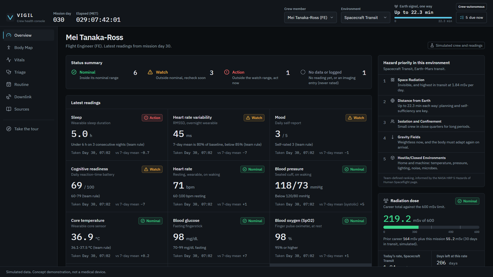
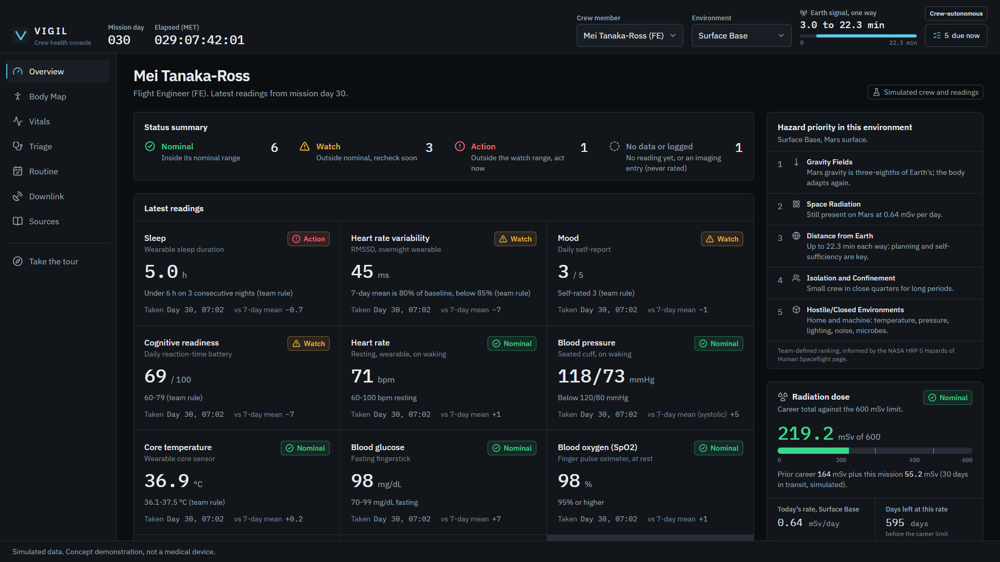
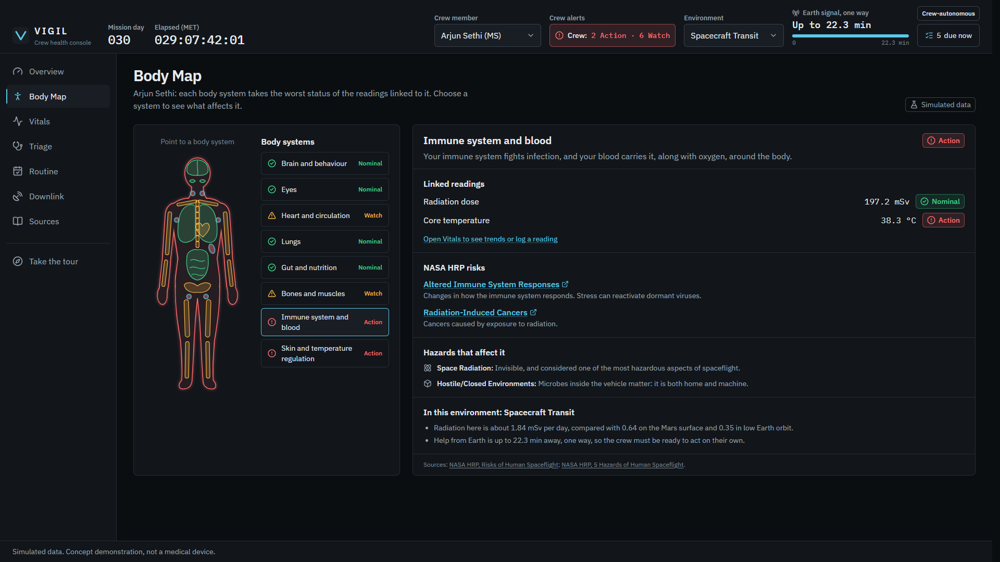
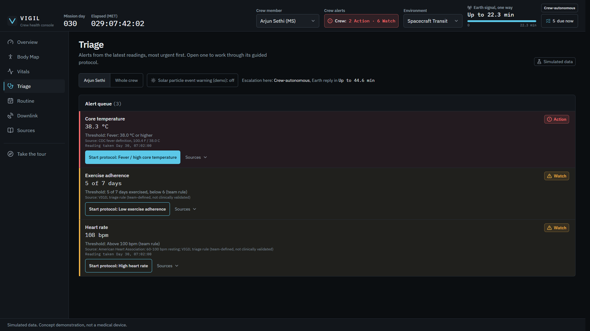
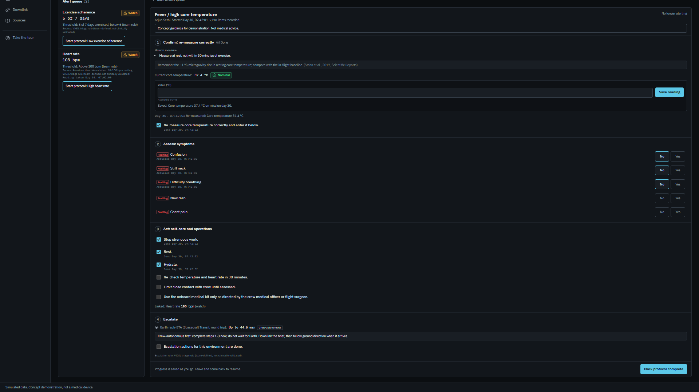
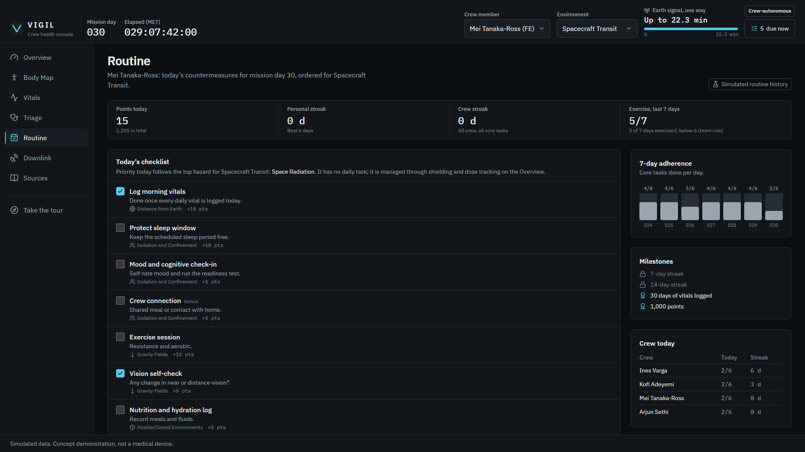
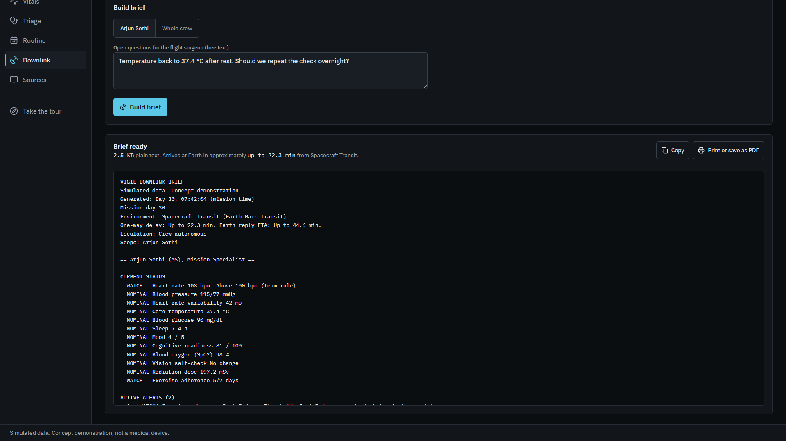
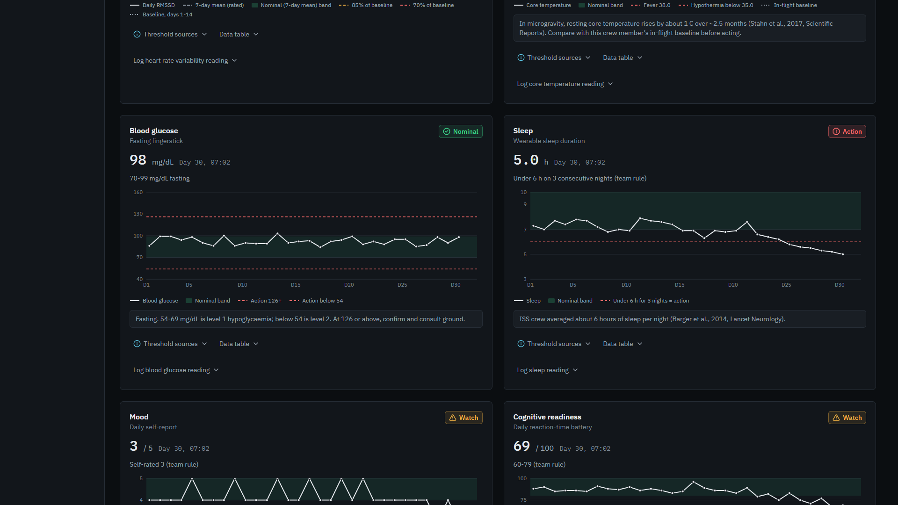

# VIGIL

**Live app:** https://vigil-pandas.vercel.app
**Repository:** https://github.com/Kuraam/vigil
**Demo deck (7 slides):** [PDF](https://vigil-pandas.vercel.app/VIGIL-demo-deck.pdf) (official submission) | [PowerPoint](https://vigil-pandas.vercel.app/VIGIL-demo-deck.pptx) (editable) | [Browser presentation](https://vigil-pandas.vercel.app/deck/) (arrow keys, F for fullscreen)

> **Simulated data. Concept demonstration, not a medical device.**

## What VIGIL is

VIGIL is a crew health console for long missions. It helps astronauts who are not physicians answer three questions about themselves and their crewmates, without waiting for Earth:

1. **What is my status?** Every reading is rated nominal, watch or action against a threshold with a cited source.
2. **Why does it matter here?** Readings are linked to body systems, to NASA's named spaceflight risks and to the environment the crew is in.
3. **What do I do now?** A guided protocol walks the crew through confirming, assessing, acting and escalating.

Built by Pandanauts for the NASA Space Apps Challenge 2026, challenge *Create Health Monitoring Software for Astronauts on Space Missions*.

## The problem

NASA's Human Research Program groups the dangers of human spaceflight into five hazards: space radiation, isolation and confinement, distance from Earth, gravity fields, and hostile or closed environments. They can feed off one another and worsen effects on the body.

On the way to Mars, a signal takes up to about 22 minutes to reach Earth, and as long again for the answer. A crew cannot wait 45 minutes to learn whether a fever matters. NASA HRP names this gap the **Risk of Inadequate Systems Operations Support**. VIGIL is built for that situation: Earth-independent care, where the crew assesses itself first and Earth advises when it can.

## Features

- **Overview.** Status summary and latest readings for each crew member, most urgent first; hazard priority for the current environment; radiation dose against the career limit; the five hazards.
- **Vitals.** A 30-day chart per vital with the nominal band, threshold lines and personal baseline; the source of every threshold; a data table; keyboard log forms; an imaging log.
- **Body Map.** Eight body systems, each rated by its linked readings and linked to named NASA HRP risks, the hazards that affect it, and how the environment changes things.
- **Triage.** An alert queue for one crew member or the whole crew, and ten guided protocols. Each step is timestamped and saved, so a protocol can be resumed.
- **Routine.** A daily countermeasure checklist with points, personal and crew streaks, a 7-day adherence bar and milestones.
- **Downlink.** A compact plain-text brief for the next communication window, with copy, print or save as PDF, its size and the time it takes to reach Earth.
- **Sources.** Every source with where it is used, an About section and the AI-use statement.
- **Works offline.** After one visit everything runs on the device, installable as an app. A badge shows Online or Offline: running on device.
- **First visit.** A "Start here" panel and a 60-second guided tour. "Reset demo data" on the Sources page restores the seeded state.

There is no backend, account or network call: all processing happens on the device.

## Works offline

A deep-space crew cannot depend on servers on Earth. After one visit, VIGIL is stored on the device as an installable app (a Progressive Web App), so every page, protocol and the Downlink brief work with no network connection. No health data leaves the device.

To check it yourself:

1. Open https://vigil-pandas.vercel.app once, in Chrome or Edge.
2. Wait for the toast **Ready to work offline.** (the badge at the top left reads **Online**).
3. Switch off Wi-Fi (or set DevTools > Network to Offline).
4. Reload. The badge now reads **Offline: running on device**.
5. Use every page: Overview, Body Map, Vitals, Triage (start the fever protocol for Arjun Sethi), Routine, Downlink (build the brief) and Sources.

To install it, use the browser's install icon in the address bar, or **Install app** on the Sources page when the browser offers it. When a new version is deployed, VIGIL shows **Update available** with a Reload button; it never reloads by itself in the middle of a protocol. The demo deck PDF is not stored for offline use.

## How it works

**Thresholds with sources.** Each threshold value is stored with its unit and the source it comes from (`src/data/thresholds.ts`), and a test fails if any value cites a source that is not in the registry (`src/data/sources.ts`). Where published figures leave a gap, the tier is a team rule and is labelled "VIGIL triage rule (team-defined, not clinically validated)". Some rules use history: heart rate variability against a day 1-14 baseline, three short nights of sleep in a row, a three-day fall in mood.

**Triage and protocols.** Any watch or action reading becomes an alert. Each protocol has four parts: confirm (re-measure correctly), assess (a symptom checklist with red flags), act (low-risk self-care and operational steps) and escalate. VIGIL never names medications or doses; where treatment may be needed it says: "Use the onboard medical kit only as directed by the crew medical officer or flight surgeon." Any red flag escalates at once.

**Comm-delay escalation.** Earth's reply time is the round trip, twice the one-way delay. In low Earth orbit the rule is ground-guided: consult the flight surgeon now. Everywhere on the Mars mission profile it is crew-autonomous first: complete the first three steps, downlink the brief, then follow ground direction when it arrives.

**Radiation model.** Career dose is a simulated prior dose plus mission dose at published daily rates: 1.84 mSv/day in cruise and 0.64 mSv/day on the Mars surface (Curiosity RAD), about 0.35 mSv/day in low Earth orbit. It is compared with the 600 mSv career limit in NASA-STD-3001, and VIGIL shows the days left at today's rate.

## NASA and partner data used

- NASA HRP, 5 Hazards of Human Spaceflight: hazard panel, Body Map hazard lines, hazard priorities.
- NASA HRP, Risks of Human Spaceflight: risk names on all eight Body Map zones and in the protocols.
- NASA HRP, Ongoing HRP Research: research cards on the Routine page and Body Map, labelled "NASA research in progress" where applicable.
- NASA-STD-3001 Vol 1 [V1 4030] and [V1 4031]: career and solar particle event radiation limits.
- NASA MSL/Curiosity RAD (Zeitlin et al., 2013; Hassler et al., 2014): cruise and Mars-surface dose rates.
- NASA ISS crew dosimetry: Orbital Station dose rate.
- NASA Mars Relay Network: one-way signal delay.
- Canadian Space Agency, Monitoring Radiation for Astronaut Health (2026): neutron note in the radiation panel.
- Canadian Space Agency, Why Do We Conduct Science Experiments in Space?: listed on the Sources page.

NASA does not endorse any non-U.S. Government entity. Non-NASA sources are used under their own terms of use. The full list with links is on the app's Sources page and in [docs/submission/nasa-data.md](docs/submission/nasa-data.md).

## Other references

American Heart Association (blood pressure categories, low blood pressure, resting heart rate, how to measure blood pressure); American Diabetes Association (Standards of Care, 15-15 rule); CDC fever definition; the clinical definition of hypothermia; WHO Pulse Oximetry Training Manual (2011); AASM/SRS 2015 sleep consensus; Barger et al., 2014; Stahn et al., 2017; Basner et al., 2015.

Offline support uses vite-plugin-pwa (MIT) and Workbox (MIT). Every library with its licence is listed in [docs/submission/space-agency-partner-data-and-references.md](docs/submission/space-agency-partner-data-and-references.md).

## Use of AI tools

- **Planning and research.** We used Claude (Anthropic) as a chat assistant to plan the build, research sources and write step-by-step instructions for the coding assistant. It suggested the initial product structure, the threshold values and their published sources, and the protocol content. We reviewed these, checked the sources, decided what to keep and made the final product decisions.
- **Code.** The code was written with Claude Code, an AI coding assistant, following those instructions, including the tests, the screenshot and deck scripts, and first drafts of the documentation. We reviewed and edited the results at each stage.
- **Content.** Thresholds, hazard and risk wording, and protocol steps come from the cited NASA, CSA and clinical sources, and each one shows its source in the app. Both assistants were told not to add clinical facts, and protocols never name medications or doses. Rules we defined ourselves are labelled as team rules.
- **Images.** No images were generated by AI. Every picture is a screenshot of VIGIL taken by a script in the repository; the VIGIL mark and the Body Map figure are simple vector shapes written as SVG code.
- **Data.** All crew members and readings are simulated by a seeded program. No real health data was used.

Full statement: [docs/submission/ai-use.md](docs/submission/ai-use.md).

## Licence

VIGIL is released under the [MIT License](LICENSE). Copyright (c) 2026 Pandanauts.

## Limitations

- All crew and readings are simulated from a fixed seed. Nothing comes from a real person or sensor.
- Several tiers, the escalation rule, the hazard ranking and the routine scoring are team-defined rules, labelled as such.
- Nothing in VIGIL has been clinically validated. It is a concept demonstration, not a medical device.
- Data is stored only in the browser that uses it.

## Future work

- Real input from wearables and medical devices.
- Native tablet packaging for use on board.
- Validation of thresholds, rules and protocols with flight surgeons.
- More environments, such as Moon and Mars bases.

## Team

<!-- team:start -->
**Pandanauts**

- Ahmad Kura Muhammad, Team Lead
- Muhammad Danjuma, AI Engineer
<!-- team:end -->

## How to run

Requires Node 20.19 or later.

```bash
npm install
npm run dev          # http://localhost:5173
```

| Command | What it does |
| --- | --- |
| `npm run dev` | Development server |
| `npm run build` | Type check and production build into `dist/` |
| `npm run preview` | Serve the production build |
| `npm run typecheck` / `npm run lint` | TypeScript check / oxlint |
| `npm test` | Unit tests (Vitest) |
| `npm run smoke` | Browser check of every route, the tour, reset and the end-to-end fever path. Set `SMOKE_URL` to test a running build |
| `npm run screenshots` | Regenerate `docs/screenshots/` (1920x1080) |
| `npm run deck` | Render `docs/deck/index.html` to the 7-page PDF in `docs/` and `public/` |
| `npm run deck:pptx` | Rebuild the deck as an editable PowerPoint (`docs/VIGIL Demo Deck.pptx`, `public/VIGIL-demo-deck.pptx`) and check its text against the PDF |
| `npm run deck:web` | Copy the deck to `public/deck/` as a browser presentation (served at `/deck/`) |
| `npm run offline` | Offline test against a production build (`npm run build` first) or `OFFLINE_URL`: precache, every route offline, the fever path offline |
| `npm run icons` | Render the app icons in `public/icons/` from the VIGIL mark |
| `npm run sync:team` | Copy the team from `src/data/team.json` into the README, submission files and deck |

The smoke, screenshot and deck scripts use an installed Chrome or Edge; set `CHROME_PATH` if needed. On Windows, run tests with `npm test` rather than `npx vitest`: the wrapper fixes a Vitest bug with lower-case drive letters.

Project layout: `src/types` (domain model), `src/data` (sources, thresholds, protocols, simulation), `src/lib` (pure logic, all unit-tested), `src/features/<page>` (screens), `src/app` (shell and router), `src/styles/tokens.css` (all colours and fonts).

## Screenshots

| | |
| --- | --- |
|  |  |
|  |  |
|  |  |
|  |  |
